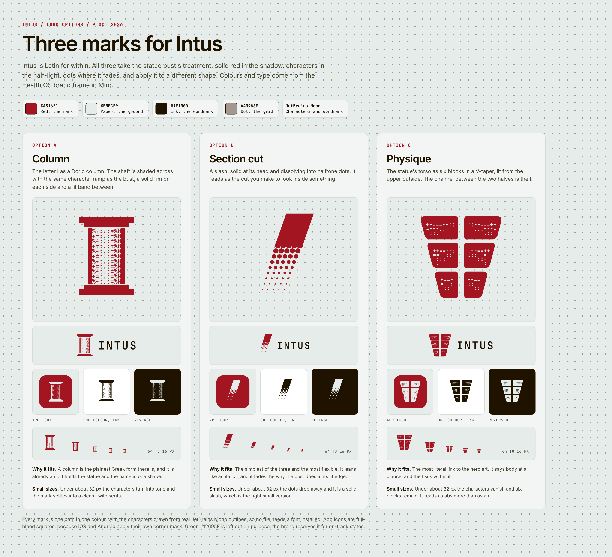

# Intus logo options

**Chosen: option B, the section cut (11 Oct 2026).** It is live in the app (`src/components/brand.tsx`), the favicon, the Apple touch icon and the link preview image (`public/`). Options A and C are kept here for the record.

Three marks, all built from the Health OS brand frame in Miro ("04 Visual language"): red `#A31621`, paper `#E5ECE9`, ink `#1F1300`, dot `#A3988F`, with JetBrains Mono for the characters and the wordmark. They take the statue bust's treatment (solid red in the shadow, characters in the half-light, dots where it fades) and apply it to three different shapes.



| Option | Mark | Idea | At small sizes |
| --- | --- | --- | --- |
| A, Column | `intus-a-column*.svg` | The letter I as a Doric column, shaded across with the bust's character ramp. | Under about 32 px the characters turn into tone and it settles into an I with serifs. |
| B, Section cut | `intus-b-slash*.svg` | A slash, solid at its head and dissolving into halftone dots, like the cut you make to look inside. | Under about 32 px the dots blend into a soft fade down the slash. |
| C, Physique | `intus-c-physique*.svg` | The statue's torso as six blocks in a V-taper. The channel between the halves is the I. | Under about 32 px the characters vanish and six blocks remain. It reads as abs more than as an I. |

## Files

Each option has six files, named `intus-<letter>-<name>` plus a suffix:

- no suffix: the mark in red, on a transparent ground
- `-ink`, `-paper`: the same mark in one colour, for light and dark grounds
- `-lockup`: the mark with the INTUS wordmark in ink, tracked 0.12em as in the app
- `-lockup-reversed`: the lockup in paper, for red or ink grounds
- `-icon`: paper mark on a full-bleed red square. iOS and Android apply their own corner mask, so the square has no rounded corners.

Every mark is one path in one colour, with the characters drawn from real JetBrains Mono outlines, so no file needs a font installed.

## Notes

- Miro's design system keeps red for the one main action on a screen. Where that matters, such as the app header next to a red button, use the `-ink` mark.
- Green `#12695F` is left out on purpose. The brand reserves it for on-track states.
- Nothing here has had an app store, trademark or visual similarity check. `docs/product/naming.md` lists the filters to run before one is chosen, and the options should be compared against Bevel, Whoop and Oura marks too.
- At small sizes, the dots of option B blend into a soft fade, so the app uses the one drawing from a 16 px tab icon up to the hero. The favicon is the mark in paper on a red tile, because a bare red mark disappears on a dark browser tab.

## Regenerating

The three options:

```
npm i --no-save @fontsource/jetbrains-mono
pip install fonttools
python3 scripts/brand_logos.py --fonts node_modules/@fontsource/jetbrains-mono/files --out docs/brand/logos
```

The geometry for each option is a short function in `scripts/brand_logos.py`.

The production assets for option B (the app's mark, `public/favicon.svg`, the link preview source), then the pictures made from them (`favicon.ico`, `apple-touch-icon.png`, `og.png`):

```
python3 scripts/brand_assets.py
npm i --no-save playwright-core && pip install pillow
node scripts/brand_rasters.mjs
```

## App icons

Option B is a vector, so every size is rendered from the same path and nothing is redrawn by hand or by an image model. `scripts/brand_app_icons.mjs` writes the phone app icons and two high definition masters:

| File | Use |
| --- | --- |
| `mobile/assets/icon.png` | iOS icon, 1024 px, paper mark on full-bleed red. RGB with no alpha channel, because Apple rejects one. No rounded corners, iOS rounds them. |
| `mobile/assets/android-icon-foreground.png` | Android adaptive icon, paper mark on transparent, inside the 66 of 108 unit safe circle |
| `mobile/assets/android-icon-background.png` | Android adaptive icon, solid red `#A31621` |
| `mobile/assets/android-icon-monochrome.png` | Android themed icon, one-colour mark on transparent (Android tints it) |
| `mobile/assets/splash-icon.png` | Splash image, red mark on transparent |
| `mobile/assets/favicon.png` | 48 px web favicon for Expo, from `public/favicon.svg` |
| `docs/brand/app-icons/intus-app-icon-2048.png` | The iOS icon at 2048 px, for stores, decks and design tools |
| `docs/brand/app-icons/intus-mark-red-2048.png` | The red mark on transparent at 2048 px |

```
npm i --no-save playwright-core && pip install pillow
node scripts/brand_app_icons.mjs
```

If a larger raster is needed, change the size in the script. `docs/brand/logos/intus-b-slash*.svg` stays the master.
